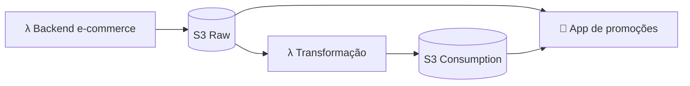

# ☁️ Data Lake Simples na AWS

Projeto de criação de um Data Lake simples utilizando os serviços da **Amazon Web Services**. Utiliza o **S3** (Simple Storage Service), **Lambda** e **EventBridge**.

## Sumário

1. [Visão geral da solução](#-visão-geral-da-solução)
2. [Fluxo de dados](#-fluxo-de-dados)
3. [Observação](#-observação)

---

## 🧩 Visão geral da solução

De forma simples, a solução criada pode ser destrinchada da seguinte forma:

| Componente | Serviço AWS | Papel |
|------------|-------------|-------|
| **Backend do e-commerce** | Lambda | Processa a compra e envia os dados para a camada Raw |
| **Camada Raw** | S3 (bucket) | Recebe os dados enviados pelo backend |
| **Transformação** | Lambda | Transforma os dados recebidos e envia para a camada Consumption |
| **Camada Consumption** | S3 (bucket) | Armazena os dados transformados |
| **Aplicativo de promoções** | - | Acessa as camadas Raw e Consumption e agrega os dados |

---

## 🔄 Fluxo de dados

1. O backend de um aplicativo de e-commerce (o que realmente processa a compra) é uma **função Lambda**. Essa função envia os dados para um Bucket no S3 que é a **camada Raw**.
2. Depois disso, outra **função Lambda** vai transformar os dados recebidos e enviar para uma **camada Consumption**, também um bucket no S3.
3. Depois disso feito, um **aplicativo de promoções** acessa os dados tanto Raw quanto Consumption no S3 e agrega eles de forma a ter dados de quais produtos foram abandonados e oferecer descontos.

---

## 📝 Observação

> **OBS:** Dá pra ver que esse é um exemplo mais simples de um Data Lake porque geralmente ele tem 3 camadas (**Raw**, **Staging** e **Consumption**). Você também pode adicionar mais camadas conforme necessário.
